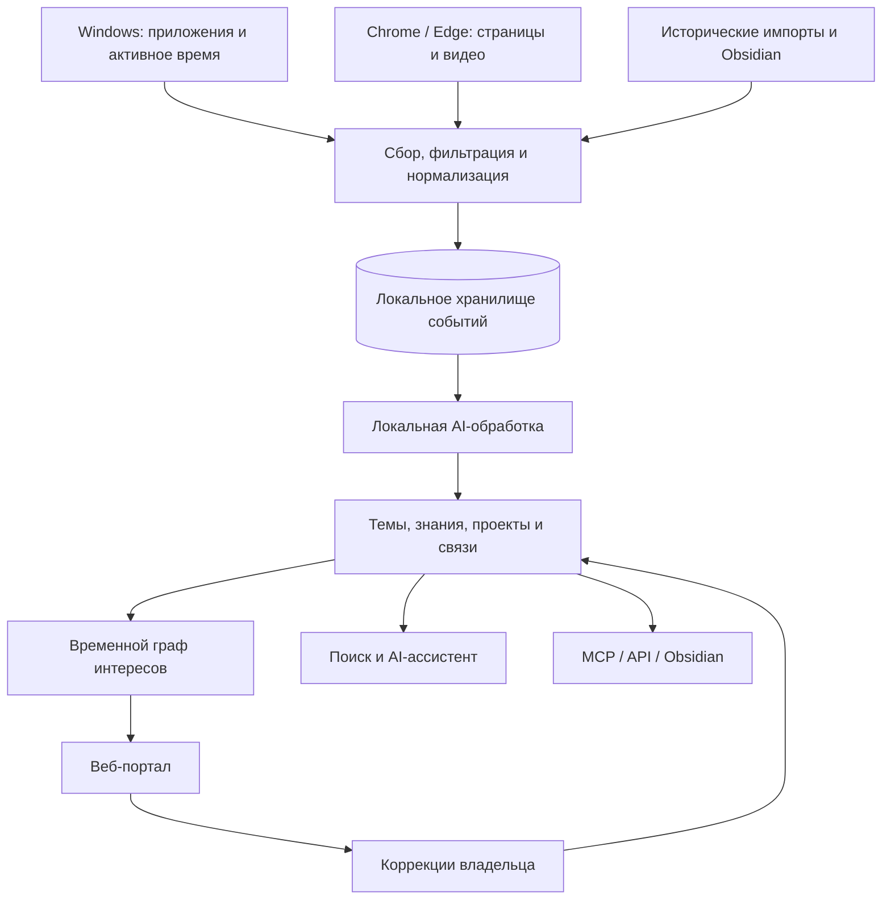
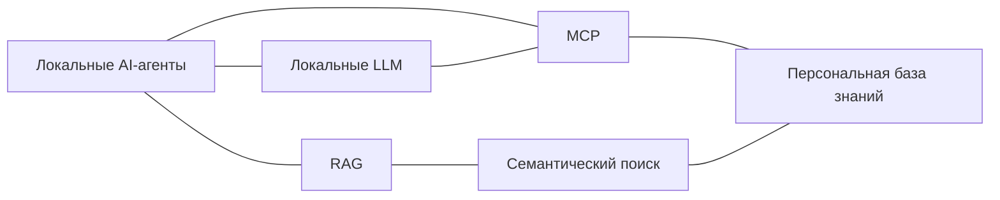

# PersonalContext

**Твой актуальный цифровой контекст — в одном месте.**

PersonalContext — персональная local-first система, которая помогает понять, чем ты занимаешься, что изучаешь, какие темы и проекты тебя интересуют сейчас и как эти интересы меняются со временем. Она превращает разрозненные следы цифровой активности в связанную, проверяемую базу знаний, доступную через веб-портал и локальные AI-агенты.

> Статус: проектирование завершено, реализация запланирована в [GitHub Issues](https://github.com/Egkurilov/PersonalContext/issues). Ниже описана целевая функциональность первой версии, а не уже доступные возможности.

## Главное: польза, а не статистика

PersonalContext не просто показывает, чем ты интересуешься. Он должен самостоятельно находить полезные связи и возможности: какие новые материалы стоит изучить, где применить прежние исследования, какие решения пора пересмотреть, к какому проекту вернуться. **Personal Intelligence Engine** работает в фоне и предлагает только небольшое количество обоснованных идей, когда пользователь сам открывает портал. До 3 новых рекомендаций в день, никакой навязчивой рассылки, попапов и звуков. Нет полезных идей — нет карточек.

Локальный анализ сопоставляет интересы с подтверждёнными целями, проектами и долгосрочной памятью. Опционально пользователь разрешает мониторинг конкретных публичных RSS, GitHub releases и changelog. Внешнее исследование по умолчанию выключено; личный контекст не отправляется в поисковые сервисы. Тяжёлые операции откладываются во время игры или высокой нагрузки ПК. Подробности: [Personal Intelligence Engine](docs/INTELLIGENCE.md).

## Зачем нужен PersonalContext

Каждый день мы читаем статьи, смотрим видео, изучаем документацию, обсуждаем идеи с AI, работаем с кодом и записываем мысли. Через несколько недель сложно вспомнить не только конкретный материал, но и весь контекст: почему заинтересовался технологией, что уже исследовал, с какими проектами она связана и что осталось проверить.

Обычная история браузера отвечает на вопрос «какой сайт я открывал». Трекер активности — «сколько времени я провёл в приложении». Заметки требуют ручного ведения. PersonalContext объединяет эти сигналы и помогает отвечать на более полезные вопросы:

- Чем я действительно занимался на этой неделе?
- Какие темы приобретают актуальность, а какие отходят на второй план?
- Что я уже изучил по конкретной технологии и где находятся исходные материалы?
- Какие идеи пересекаются с моими текущими проектами?
- Какой контекст передать AI-агенту, чтобы не объяснять ему всё заново?

Главная идея — **не просто хранить историю, а непрерывно поддерживать актуальный, независимый от конкретной LLM персональный контекст**. Веб-интерфейс делает его понятным человеку, API и MCP — доступным другим программам, а Obsidian — переносимым.

## Как это работает

1. Пользователь явно разрешает сбор конкретных типов активности на своих устройствах и задаёт исключения.
2. Windows-агент и браузерное расширение фиксируют разрешённую активность. Исторические данные можно добавить из выбранных экспортов и заметок.
3. Система очищает и нормализует события, объединяет дубликаты и сопоставляет материалы, приложения и сессии. Посещение сайта не приравнивается к прочтению статьи.
4. Локальная AI-модель определяет темы, извлекает знания и возможные связи между материалами и проектами. Каждый вывод привязан к источникам, а неопределённость отображается явно.
5. Детерминированный алгоритм рассчитывает актуальность интересов с учётом свежести, повторяемости, длительности и качества сигналов. Граф и история изменений обновляются по мере поступления новых данных.
6. Пользователь смотрит результаты, исправляет неверные классификации, ищет материалы и передаёт разрешённый контекст своим AI-инструментам.

## Интерактивный HTML-прототип

[**Открыть исходный HTML-прототип**](examples/personalcontext-dashboard.html) · [Инструкция и сценарии проверки](examples/README.md).

Автономный дизайн-референс PersonalContext v1.3: плотный тёмный дашборд, текстовый аналитический обзор, три обоснованные рекомендации с источниками и следующим шагом, карта интересов, цели и восстановление проектного контекста. Чтобы посмотреть интерфейс, скачайте HTML через GitHub (Download raw file) и откройте его в браузере. Никакой сервер, сборка или установка зависимостей не нужны. Все данные синтетические; взаимодействия сохраняются только в localStorage, если доступно. Реальный сбор, LLM и внешние запросы не выполняются.

## Что увидит пользователь

PersonalContext — это веб-портал для собственного использования. После настройки источников большая часть наполнения происходит автоматически. Портал доступен на ПК, MacBook и смартфоне на самом ПК через встроенный сервер; с других устройств — только при отдельном включении защищённого LAN/VPN HTTPS.

| Раздел | Что показывает и позволяет делать |
|---|---|
| **Обзор** | До трёх новых обоснованных возможностей, подтверждённые цели, актуальные интересы, проекты и изменения фокуса; статистика ниже. |
| **Рекомендации** | Почему предложено, что нового, практический следующий шаг, источники; сохранить, скрыть, оценить или отметить применение. |
| **Цели и память** | Подтверждённые цели, знания, проектные решения и их история; ручная коррекция и удаление. |
| **Исследования / Technology Radar** | Опциональные разрешённые публичные источники, значимые релизы и изменения, причины рекомендации и состояние проверки. |
| **Карта интересов** | Интерактивный граф тем, подкатегорий и связей. Можно выбрать тему, увидеть её динамику и материалы, на основании которых она сформирована. |
| **Хронология** | Что и когда открывал, изучал или использовал; поиск по времени, приложению, источнику и устройству. |
| **Знания** | Найденные материалы, конспекты, связанные понятия, собственные заметки и ссылки на первоисточники. |
| **Проекты** | Материалы и исследования, связанные с конкретными проектами. Предложенные AI связи можно подтвердить или отклонить. |
| **Поиск и AI-ассистент** | Семантический поиск и вопросы к собственной истории с проверяемыми ссылками на источники. |
| **Дайджесты** | Изменения интересов, новые темы, связанные материалы и открытые вопросы за выбранный период. |
| **Источники и приватность** | Подключение устройств, состояние сбора, разрешения, исключения, пауза, экспорт и удаление данных. |

### Пример: от истории браузера к карте интересов

Допустим, в течение двух недель пользователь читает документацию по RAG, сравнивает локальные LLM, изучает MCP и ведёт заметки по разработке AI-агентов.

PersonalContext может обнаружить направление «Локальные AI-агенты» и связать его с темами «RAG», «LLM», «MCP» и проектом «Персональная база знаний». В карточке темы появятся исходные материалы, дата первого и последнего наблюдения, динамика актуальности и объяснение связей. Если связи оказались неверными, пользователь сможет их исправить.

Это иллюстративный пример, не реальные данные. Частое посещение ресурса не обязательно означает личный интерес: оно может быть рабочей обязанностью. Поэтому система различает наблюдаемые действия, предполагаемые интересы и подтверждённые владельцем выводы. Связь в графе не является доказательством причинности.

### Пример: персональный контекст для разработки

Перед началом работы над проектом локальный AI-агент запрашивает через MCP актуальную информацию: связанные материалы, темы, предыдущие исследования и разрешённые заметки. Вместо повторного поиска с нуля он получает релевантный контекст с источниками.

MCP в первой версии работает только на чтение. Он не получает права запускать программы, менять настройки приватности, читать произвольные файлы или выполнять действия от имени владельца.

## Источники данных первой версии

| Источник | Какие данные планируется получать |
|---|---|
| Windows 11 | Активное приложение, разрешённый заголовок окна, активное время, idle/lock/sleep. |
| Chrome / Edge | Посещения, видимые активные вкладки, безопасные заголовки и URL, время активности, текст разрешённых страниц. |
| YouTube / HTML5 video | Измеряемые интервалы воспроизведения на разрешённых страницах; отдельно — импорт исторических записей просмотра. |
| История браузера | Явно разрешённая история или выбранный экспорт; без выдуманного времени чтения. |
| ChatGPT / Codex | Выбранные пользователем экспорты разговоров и файлы с историей работы; без скрытого доступа к аккаунтам. |
| Obsidian | Выбранные заметки и папки, а также управляемый экспорт созданных знаний обратно в vault. |
| OCR Windows | Дополнительный опциональный источник текста из разрешённого активного окна, только после прохождения проверок приватности. |

**Apple-специфичный сбор исключён из v1:** нативный агент macOS, Safari и iPhone Screen Time не разрабатываются. Обычный Chrome на Mac может использовать стандартное расширение без отдельного системного агента при подтверждённой совместимости. Веб-портал остаётся доступным с Apple-устройств.

## Принципы продукта

- **Local-first.** Личные данные и AI-обработка остаются в инфраструктуре владельца. При недоступности модели базовый сбор, хронология и текстовый поиск продолжают работать; облачного fallback нет.
- **Автоматизация без тотального наблюдения.** Сбор выключен по умолчанию, источники и уровни детализации включаются отдельно, а пауза доступна в любой момент.
- **Проверяемость.** Темы, резюме и AI-ответы ссылаются на разрешённые материалы и события. Недостающие данные не заменяются выдуманными выводами.
- **Время и актуальность.** Интересы меняются: система учитывает свежесть сигналов и сохраняет динамику вместо статичного списка тегов.
- **Управление владельцем.** Пользователь может исправить, переименовать, объединить, скрыть или разделить темы и удалить исходные данные.
- **Независимость от AI-провайдера.** Открытые контракты данных, локальный модельный адаптер, API, MCP и Markdown-экспорт.

## Архитектура

Первая версия — нативное Windows-приложение на Python со встроенным веб-сервером, сборщиком, фоновыми задачами и SQLite. Установка обычным EXE, приложение в системном трее, локальный портал http://127.0.0.1:17890. Не нужны Docker, WSL, PostgreSQL или отдельная установка Python/Node. Ollama/LM Studio — опциональная отдельная модельная среда. При выключенном ПК сбор останавливается; браузер может временно держать разрешённые события в offline queue. [ADR-011](docs/adr/011-native-windows-python.md).

| Компонент | Выбранный стек |
|---|---|
| Windows-агент | Python + pywin32, pystray, встроенный collector в интерактивной сессии |
| Браузерное расширение | TypeScript, Chromium Manifest V3 |
| Backend и фоновые задачи | Python 3.12, FastAPI, встроенный Uvicorn, asyncio + durable SQLite jobs |
| Хранилище и поиск | SQLite WAL + FTS5, embeddings float32 BLOB + NumPy exact cosine, таблицы графа |
| AI-обработка | Локальный модельный сервер: Ollama или совместимый адаптер, multilingual embeddings |
| Веб-интерфейс | React, TypeScript, Vite, Cytoscape.js |
| Интеграции | REST API, read-only MCP, управляемый Markdown-экспорт в Obsidian |
| Развёртывание | PyInstaller onedir + Inno Setup per-user EXE, optional private HTTPS |

Выбор конкретных моделей и производительность должны подтверждаться тестами на русскоязычных и англоязычных данных. Подробности — в [технической спецификации](docs/SPEC.md) и [контрактах](docs/CONTRACTS.md).

## Безопасность и приватность

PersonalContext предназначен для работы со своими устройствами и данными, на сбор которых есть разрешение, а не для наблюдения за другими людьми.

- Сбор только по явному согласию; видимый статус и локальная/глобальная пауза.
- Фильтрация до записи в локальную очередь. По умолчанию исключаются приватный режим браузера, менеджеры паролей, чувствительные сайты и конфиденциальные рабочие ресурсы.
- Никакого перехвата клавиш, паролей, cookies, буфера обмена, аудио или скрытой записи экрана. Опциональный OCR не сохраняет и не передаёт изображения.
- Управляемые сроки хранения, отзыв устройств, экспорт и удаление данных с очисткой производных индексов и графа. База SQLite хранится в локальном профиле Windows с ACL; DPAPI для секретов, BitLocker рекомендуется, резервные копии шифруются. SQLite сама по себе не шифрует базу.
- Нет обязательной передачи персонального контекста внешним сервисам. Сервер не публикует БД, ingestion и модельные endpoints в интернете.

Репозиторий публичный: **реальные данные пользователя, секреты, токены, выгрузки истории, конфигурации и логи не коммитятся**. Для разработки и CI используются только синтетические фикстуры.

## План развития

| Этап | Результат |
|---|---|
| R0 — Фундамент | Инфраструктура, авторизация, политики безопасности, контракты и надёжное хранилище событий. |
| R1 — Сбор | Windows и Chromium, импорт истории, нормализация, хронология, управление приватностью и нагрузкой. |
| R2 — Интеллектуальное ядро | AI-обработка, граф, знания, поиск, долгосрочная память, цели, локальные рекомендации и feedback. Первый полезный local-only результат. |
| R3 — Интеграции | MCP, Obsidian, тихие дайджесты, опциональный исследователь, Technology Radar, восстановление контекста. |
| R4 — Приёмка | Опциональный безопасный OCR Windows, eval рекомендаций, нагрузочные и privacy проверки, установщик. Отдельный opt-in двухнедельный пилот. |

Детальная последовательность и зависимости находятся в [ROADMAP.md](docs/ROADMAP.md). Каждая задача содержит требования, Definition of Done и приёмочные сценарии. Нативные интеграции Apple исключены из текущего плана.

## Документация и разработка

| Документ | Назначение |
|---|---|
| [docs/INTELLIGENCE.md](docs/INTELLIGENCE.md) | Рекомендации, фоновое исследование, цели, память, управление нагрузкой и оценка реальной пользы. |
| [docs/SPEC.md](docs/SPEC.md) | Полное продуктовое и техническое ТЗ, функциональные и нефункциональные требования. |
| [docs/RESEARCH.md](docs/RESEARCH.md) | Исследование источников, платформенных ограничений и архитектурных решений. |
| [docs/CONTRACTS.md](docs/CONTRACTS.md) | Схемы событий, API, алгоритмы скоринга и верификация. |
| [docs/ROADMAP.md](docs/ROADMAP.md) | План реализации, зависимости и трассировка требований. |
| [AGENTS.md](AGENTS.md) | Правила работы Codex и других AI-агентов с проектом. |
| [GitHub Issues](https://github.com/Egkurilov/PersonalContext/issues) | Backlog разработки с идентификаторами PC-xxx. |

Для начала реализации — [PC-001: монорепозиторий, локальный запуск и CI](https://github.com/Egkurilov/PersonalContext/issues/1). Планируемый установщик PersonalContext-Setup.exe и инструкция появятся после реализации и проверки на чистой Windows; пока проект находится на стадии спецификации.

## Разработка PC-001

Основа приложения находится в разработке. Для локального запуска нужны Windows, uv и Node.js 24. В PowerShell выполните `./scripts/dev.ps1`. Скрипт выбирает Python 3.12.16 согласно `.python-version` (при необходимости uv загружает его), устанавливает зависимости по lock-файлам, собирает интерфейс и запускает приложение в трее. Проверки запускаются через `./scripts/test.ps1`, сборка onedir и smoke — через `./scripts/build.ps1`. Политика обновления Python описана в ADR-012.

Приложение открывает только `127.0.0.1:17890` и пока не собирает активность. `dev.ps1` запускает явно отмеченный DEMO с синтетическими примерами и отдельной базой в `%LOCALAPPDATA%/PersonalContext/demo`; обычный запуск использует `%LOCALAPPDATA%/PersonalContext/data` и показывает пустое состояние. Установщик не заменяет более новую или неизвестную установленную версию и проверяется во временном каталоге. Проверка на чистой Windows и другие критерии PC-001 ещё не завершены. Сборка пока не подписана и может вызвать предупреждение SmartScreen.

Перед миграцией существующей базы приложение создаёт проверенную копию в том же каталоге в формате `context.db.<id>.dpapi`. Копия зашифрована DPAPI и доступна тому же пользователю Windows на той же машине. Для восстановления остановите приложение и выполните `PersonalContext.exe --restore <путь-к-копии> <путь-к-новому-файлу>`. Команда создаёт новый файл и отказывается перезаписывать существующий. После проверки восстановленного файла владелец может отдельно заменить им исходную базу и сохранить исходную копию для отката. На этапе разработки вместо EXE используйте `.venv/Scripts/python -m personalcontext.storage.restore` с теми же аргументами.

Сборка формирует `dist/sbom-python.json`, `dist/sbom-frontend.json` и `dist/python-licenses.json`. Ведомости охватывают зависимости разработки и сборки вместе с рабочими зависимостями, поэтому не являются точным перечнем содержимого EXE. У самого PersonalContext лицензия в репозитории пока не указана и требует решения владельца.

`./scripts/dev.ps1` настраивает локальный Git pre-commit hook, если другой путь hooks не задан. Hook и CI проверяют содержимое Git index на возможные секреты и запрещённые пути локальных баз, ключей и выгрузок. Для проверки нужен установленный через `uv sync --locked` dev-набор. Сканер проверяет UTF-8 текст и применяет эвристики, поэтому не гарантирует обнаружение всех секретов или анализ бинарных файлов.
