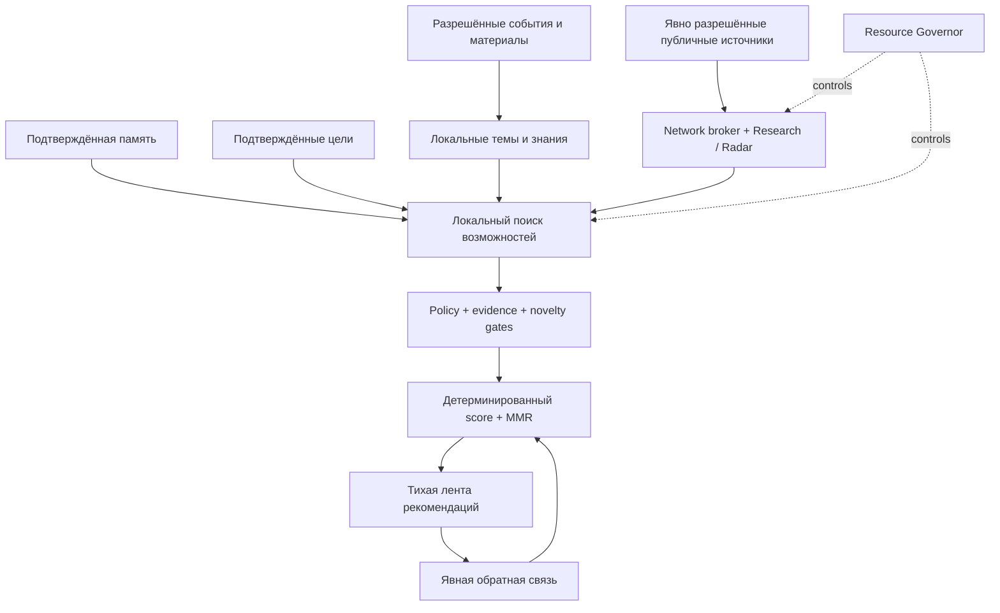

# Personal Intelligence Engine — продуктовая спецификация v1.3

Дата: 25.11.2026. Решение владельца: развить PersonalContext из цифровой памяти в фоновый персональный аналитик, который приносит применимые идеи и экономит время, не требует постоянного внимания. Нормативное дополнение к SPEC/CONTRACTS/ADR-011. Реализация в PC-026–035, интеграция с PC-012/014/017/018/019/021/023/024/025. Нативная Python Windows архитектура, SQLite/FTS5/NumPy, локальные модели, существующий React UI и durable asyncio jobs. Apple collectors по-прежнему исключены. Новых инфраструктурных сервисов нет.

## 1. Польза и пользовательские сценарии

PersonalContext не оптимизирует экранное время, количество посещений, клики и вовлечённость. Цель — небольшое число проверяемых предложений, помогающих владельцу достичь своих целей. Система должна уметь ничего не рекомендовать.

- Владелец открывает портал тогда, когда удобно: на главной до трёх наиболее полезных новых возможностей, почему сейчас и зачем именно ему, подтверждённые источники, что уже известно и что новое, конкретный следующий шаг. Статистика, карта интересов и хронология ниже/отдельно, но остаются полностью доступными. Никакого бесконечного feed.
- Владелец подтверждает цели и полезные знания, может отклонить связь, пометить тему рабочей обязанностью, скрыть/сохранить/отметить полезность/применение рекомендации. Система не выводит намерение из длительности активности, не считает молчание отрицательной оценкой, не создаёт задачи, не устанавливает ПО и не меняет проект самостоятельно.
- При возвращении к проекту пользователь открывает его карточку и видит последний подтверждённый выбор, связанные материалы, открытые вопросы, возможный следующий шаг. Никаких попапов при переключении окон.
- При отдельном opt-in пользователь задаёт публичные источники для мониторинга, например RSS, GitHub releases, changelog. Система регулярно проверяет только их, локально сопоставляет новые сведения с целями, предыдущими решениями и известными фактами. История пользователя не передаётся наружу. Отсутствие значимых изменений = нет новой карточки.
- Владелец при желании читает еженедельный digest в приложении; может запустить проверку вручную, но бюджеты и приватность действуют всегда.

## 2. Общая схема

Все модули внутри одного установленного Windows-приложения. Сначала local-only recommendations из уже имеющихся материалов (без интернета и внешнего research). PC-029/032/033/034 генерируют кандидатов; PC-030 — единственная точка публикации/ранжирования, PC-031 — feedback, PC-023 — digest уже разрешённых результатов. Не создавать параллельных лент/планировщиков. PC-026 — общий gate для AI/embeddings/OCR/research/background tasks.

## 3. Контекст и долговременная память

Контекст состоит из наблюдаемых фактов (активность), слабых гипотез, явных предпочтений, подтверждённых знаний, проектных решений и целей. Интерес != цель != намерение. В оперативной памяти today/30d — derived records со сроком исходных событий. Long-term memory — только подтверждённый владельцем компактный snapshot выбранного знания или независимо созданный им текст. Перед сохранением показать точные поля, provenance, выбранный scope и длительность. Не копировать целые архивы или чувствительные сведения. Подтверждённая запись может пережить обычное истечение evidence, сохраняя разрешённый минимальный snapshot/идентификатор и обозначение «исходник истёк»; не выдавать его за доступную цитату. При явном удалении/отзыве scope — зависимые snapshots, embeddings, feedback и derived recommendations сразу скрыть, очистить ≤24h, при independently owner-authored note явно показать её в preview и запросить выбранный scope. Ни одна копия не является способом обойти delete. Удаление пользовательских целей/предпочтений отменяет boosts. Supersession/review_due (90d initial), stale labels; не считать старое знание актуальным автоматически.
Goal Engine: ручные draft/active/paused/done/archived; priority, outcome/success criteria, optional date, project, topics, constraints, revision, evidence. AI drafts только с доказательствами, не подтверждает сам. User-set priorities имеют больший смысл, чем время в приложениях. Устойчивые интересы/обязанности/неинтересные темы корректируются пользователем. Sensitive-trait inference запрещён.

## 4. Data contract (SQLite)

Схемы расширяются миграциями согласно CONTRACTS и ADR-011; UTC timestamps, owner scoped, FK + indexes, short single-writer transactions, idempotency and tombstones. 
- memory_items(id,kind,scope,text,snapshot_confirmed,provenance_refs,status,revision,supersedes,confirmed_at,review_due,expiry_at,updated_at); memory_evidence, revisions; versioned embeddings/FTS.
- goals(id,title,description,project_id,priority,status,target_date,success_criteria,owner_confirmed_at,review_at,constraints,revision); goal_links, goal_revisions, explicit preferences.
- research_subscriptions(id,source_type,approved_endpoint,scope,enabled,cadence,approved_at,last_checked,next_due,etag,last_modified,error); public_documents(id,subscription_id,canonical_url,external_id,published_at,fetched_at,content_hash,metadata,sanitized_text,expiry_at); radar_watch(id,subscription_id,entity,baseline_version,include_prerelease,scope); release_observations.
- candidates(id,kind,canonical_key,semantic_fingerprint,topic_ids,project_ids,goal_ids,source_refs,why_now,why_for_me,known_vs_new,action,confidence,features,created_at,expiry_at,producer_version,status); evidence links typed private authorized event/material/memory/goal or public document/release. External claims require source URL, publication date when available, fetched_at, and minimal licensed summary/quote. Owner-created item marked as owner-provided.
- recommendations(id,candidate_id,score,rank_version,rank_features,confidence,state,presented_at,expires_at,local_day,reason,revision), recommendation_impressions(id,rec_id,displayed_at), feedback_events(action_id UNIQUE,rec_id,action,reason,created_at), preference_adjustments(scope,weight,counts,version), suppressions(fingerprint/topic/source,scope,until,reason), pilot_aggregates(period,counters); resource_state, job leases (reuse jobs table).
Candidate kinds: local_opportunity, cross_project_link, knowledge_gap, revisit_question, new_public_material, release_change, decision_update, context_restore. No freeform claim without evidence. Status suggested/ranked/presented/saved/dismissed/expired/applied; separate explicit rating. Candidate may expire sooner than evidence (initial default 7d), never later unless new verified evidence/confirmed snapshot. Card state immutable history where permitted; suppression uses minimal identifiers and honors purge. Do not persist raw network responses unnecessarily.
API examples (owner auth/CSRF): GET /recommendations?state&cursor, POST /recommendations/refresh (same gates), POST /recommendations/{id}/feedback, GET/PATCH /preferences/recommendations, CRUD /memory and /goals, GET /projects/{id}/resume, CRUD /research/subscriptions & /research/radar, GET /research/audit, POST /research/refresh, GET/PATCH /settings/resources, GET /pilot/summary, POST /pilot/start|stop|reset. Separate read-only MCP permission for selected goals/memory/recommendations if enabled; no research or feedback mutation via MCP. Contract tests validate evidence and deletion across all routes. No third-party analytics.

## 5. Ranking, filtering and calibration

Stage 1 eligibility: consent/policy active, verified accessible evidence, freshness, confidence≥0.65, specific feasible next step, not muted/dismissed/expired/known-without-new-application, no unsupported/sensitive inference. For inferred cross-topic relationship ≥2 distinct permitted materials or confirmed goal + verified source for a practical application. Publication date absent -> explicitly unknown; do not invent novelty; do not present vendor claim as measured performance. Low-confidence candidates dropped or stay local review only.
Stage 2 score: R=.25 relevance(current interest), A=.25 applicability(confirmed goal/project), N=.20 novelty(relative to prior knowledge/decisions), U=.15 practical utility, T=.10 source trust, F=.05 freshness. Each feature [0,1], auditable sources/rules, no automatic renormalization for missing features. Where no confirmed goal, applicability may use explicit project/manual interests as weaker signal, never invented goal. Base score clamp [0,1]; explicit feedback delta max ±.15 total, clamp again. Initial score≥.75, separate confidence≥.65; no minimum number to fill. Rule-based features, LLM may propose values/summaries within schema but not override gates. Version/weight config, tune on labeled dev set only, deterministic holdout eval. 
Stage 3 canonical and semantic dedup, then MMR greedy selection max(λ * score − (1−λ) * max_similarity_to_selected), λ=.75 initial, stable ties by ID. Daily budget at most 3 newly presented cards per local calendar day, ≤2 per topic; timezone changes must not reset current budget (persist window/day keys and recent 24h count conservative). Unreviewed not rated; no repeated near-identical card for 30d unless materially changed verified source and explicit change explanation; mute indefinite unless owner unmute. Budget counts first publication, not every render, persistent unique transaction; manual refresh/restart/multiple clients do not bypass. Saved/archive access separate, not counted as new. Revalidate authorization/expiry before render/query/export; invalidate on edits/deletes. 
Stage 4 feedback: useful/not useful, already known, wrong context, save, dismiss/mute, explicitly applied, undo. Minimum 5 explicit observations per dimension, shrink to prior, bounded EWMA adjustment (initial α=.2), only explicit ratings; save and click not equal applied, no attention optimization, ignore = no signal. Explain adjustments, allow reset and user override; new version only via evaluation/owner-approved change, no LLM/code self-modification.

## 6. External research: precise privacy exception to previous local-only rule

Local-only is default. Public network activity only when owner has enabled research and explicitly approved concrete HTTPS endpoint/source and cadence. Display endpoint before saving. Public endpoint subscriptions may reveal the subscribed public topic to that endpoint; never transmit private history, context, memory, project names, user prompt or generated search query. No account access/cookies, arbitrary search, user-derived outbound query, automatic browsing of links, cloud fallback, remote tool invocation or auto-install. Configured endpoint query params prohibited by default; any fixed necessary public parameter is shown for explicit approval and contains no personal data. Local model endpoint is separate existing trusted configuration. 
Single outbound broker with exact endpoint host/path allowlist, strict TLS, block loopback/private/link-local/metadata IP including IPv6, validate resolution and peer IP at connect (prevent DNS rebind), revalidate redirects, no arbitrary URL fetch; time/body/content-type limits, reject XXE/zip bombs, HTML sanitize, untrusted text never instructions. Respect rate limits/ToS/licensing/robots where applicable; fixed feeds/releases only, ETag/304, bounded backoff incl Retry-After, no burst. Record sanitized outbound audit (time/method/approved endpoint/status), owner can pause/revoke, no further network when disabled. Public documents 30d default, retention/revoke/purge all dependent cards; approved long-memory snapshots still governed by explicit revoke/deletion. Tech radar categorizes releases and meaningful delta; no auto upgrade. If unreachable/invalid/unknown, show freshness/error, do not invent updates. 
No public source required for local recommendation release; technical external module must work with mock fixtures and controlled manual allowed-source smoke. No real subscriptions configured without owner action.

## 7. Non-interruption and resource policy

| Setting | Default |
|---|---|
| OS notifications, popups, sounds, push/email | None; not implemented as delivery in v1 |
| Heavy enrichment queue consideration | Every 15 min after consent; manual start available |
| External research | Off; 6h cadence after source opt-in |
| New recommendations | ≤3 per local day; ≤2 per topic |
| Digest | Weekly inside portal after opt-in |
| Games / busy foreground / power / lock / pause | Defer heavy jobs; consent-based capture stays separately controlled |
| LLM concurrency | 1, bounded workers/queue, cancel/timeouts |
| No valuable suggestion | Empty state, no filler |

Governor: CPU/GPU >70% sustained 30s or free RAM <2GB => defer; resume only after 2min below 50% CPU/GPU and memory OK, configurable. GPU adapter optional NVIDIA NVML, unavailable = unknown/conservative policy, use process/game/CPU signals; no claim of exact GPU availability. Never forcibly kill Ollama/LM Studio process. In-flight cancellation best-effort with bounded timeout, visible status; manual override requires explicit action, never bypasses privacy. App shutdown/sleep no background operation, bounded idempotent catch-up, no wake schedule. Test Windows game foreground and resource pressure. User can fully stop capture, research and analysis independently. All tasks use PC-026, no new background processes/services.

## 8. UX and explanation

Overview opens on "Стоит обратить внимание" (max 3 qualified new cards), then confirmed goals/context, map/statistics. /recommendations: new/saved/applied/history, reason controls, why now/known vs new/action and safe source links, confidence, no misleading urgency or fake time estimate. /memory, /goals, /research (subscriptions/radar/outbound audit), /projects/{id}/resume, /settings/resources, /settings/privacy, pilot quality panel. Existing timeline/knowledge/graph/search/assistant remain. Empty/stale/paused/offline/coverage/consent states, responsive 360px and WCAG/keyboard. Display only valid evidence; do not nag for ratings. Digest from same ranked cards, no separate candidate publishing quota. 
Cold start: select a few interests/goals optionally, import permitted browser/notes, run local processing manually or wait for scheduler while app running; if not enough evidence, show honest onboarding/empty. User sees first local opportunities without configuring internet. Local assistant can answer from confirmed memory and explicit goals under same access rules, not autonomously research.

## 9. Evaluation and pilot

Technical gates PC-035 (independent of PC-025 infrastructure): ≥120 labeled synthetic/public licensed candidate cases, ≥40 RU, held-out labels and reproducible fixed seed, evaluate useful/not useful/duplicate/known/unsafe/mismatched, pairwise ordering, baseline relevance-only vs new rank. Initial precision@3≥.75 across eligible labeled queries (report coverage/no-result count, avoid metric gaming through abstention), evidence resolution and authorization 100%, exact duplicate zero and semantic duplicates ≤5% of surfaced cards, daily cap 100%, zero unauthorized egress/notification/consent leakage. Report precision, coverage, false negatives and counterexamples; separate model quality from deterministic ranking, tune on dev only. Negative tests: conflicting goals/interest, cold start, no evidence, malicious webpage/SSRF, rate/offline/restart, deletion/retention, feedback reset, game/pressure. Technical gates mandatory, not claims before testing.
Owner opt-in 14-day pilot after first local useful slice PC-030/031. Count impressions, explicitly rated, useful/rated, saved separately, confirmed applied per week; target ≥70% useful among rated with ≥10 explicit ratings, response rate and denominator shown, ≥1 applied idea/week, zero unwanted interruptions (owner reports + technical event checks). Optional user-estimated time saved labeled subjective. No forced ratings or click/time targets. Insufficient data or no pilot = explicit status not_run/insufficient, not success; no actual personal data in repo. Pilot informs owner approval and tuning, can run before external module; release technical checks mandatory, real pilot result not fabricated or automatic block if owner has not opted in. 
## 10. Implementation and scope
- Early R1: PC-026 resource governor integrated before heavy AI.
- R2: PC-027 confirmed memory, PC-028 goals, PC-029 local opportunities, PC-030 rank/feed, PC-031 feedback. First useful local slice after these with historical imports and local search. No external feeds required.
- R3: PC-032 opt-in public research, PC-033 radar, PC-034 context restore, existing PC-023 digest assembled from same feed.
- R4: PC-035 evaluation, PC-025 full release gate. PC-024 OCR optional only after privacy capability proof.
See ROADMAP for exact dependency DAG. User goals approved; no new external service infrastructure or extra platform scope. All requirements must be demonstrably implemented; not merely described.
