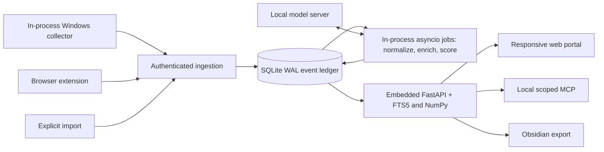

# PersonalContext — продуктовая и техническая спецификация v1.2

Дата проектирования: 24.11.2026. Статус: целевая спецификация, реализация не начата. Русский UI по умолчанию, английский через i18n. Стабильные идентификаторы требований и задач — в ROADMAP.md. Контракты и тесты — CONTRACTS.md.

## 1. Цель и результат

Система на собственных устройствах владельца собирает разрешённые сигналы цифровой активности, преобразует их в доказуемый и обновляемый контекст: чем человек занимался, что читал/смотрел, какие темы и проекты стали актуальны, какие знания и намерения обнаружены. Это не система контроля сотрудников, не диагноз личности, не скрытый мониторинг и не тотальная запись экрана. Ценность: при открытии веб-портала видеть текущую карту интересов и её динамику, восстановить найденный материал, понять, почему изменился фокус, и передавать только релевантную часть контекста локальным агентам.

Целевая аудитория v1: один владелец, несколько лично контролируемых устройств: Windows 11 x64 и Chromium-браузеры (Chrome/Edge на Windows, обычный Chrome на macOS как browser-only без native agent). Нативный macOS, Safari, iPhone/Screen Time и Apple-specific SDK исключены из v1 по решению владельца 24.11.2026; Apple-устройства остаются клиентами веб-портала. Одна per-user Windows 11 x64 установка PersonalContext.exe в интерактивной сессии владельца; встроенные API, collector и фоновые задачи. По умолчанию доступ через http://127.0.0.1:17890; опционально private LAN/VPN HTTPS с отдельным opt-in. Никаких Docker/WSL, отдельно установленной БД, отдельного worker или reverse proxy. Не публиковать ingestion и модельный сервер в интернете. Один пользователь, не multi-tenant; отдельные identities для browser sources; локальный Windows collector — internal identity. Только одна установленная host-копия в v1. Реальные данные не размещаются в GitHub и не передаются внешним LLM. Внешние источники только по явному запросу и без передачи профиля по умолчанию.

### Продуктовые сценарии
- Включить источник, увидеть его разрешения, область сбора, состояние и дату последнего успешного события. Остановить сбор немедленно, локально даже офлайн, и глобально с применением при первом соединении; статус offline/pause pending честный.
- Открыть обзор: «чем я сейчас занимаюсь», топ актуальных тем, новые/угасающие, источники, изменения за 7/30/90 дней, фокус сегодня, предложения. Ноль данных = пустой экран и понятная подсказка, не фиктивный граф.
- Найти в хронологии конкретный материал, приложение, сайт, видео или заметку; открыть исходную ссылку и связанный проект; фильтровать по периоду, источнику и устройству.
- Исследовать граф: выбрать тему → подкатегории, соседние темы, проекты, время первого/последнего наблюдения, скоринг и объяснение с источниками. Поменять имя, объединить/разделить, закрепить, скрыть, пометить неверную классификацию или «рабочая обязанность, не интерес». Исправление сохраняется при повторном анализе.
- Сформулировать запрос: «Что изучал по теме X в этом месяце?», «Что изменилось?», «Что не завершил?». Ответ содержит ссылки на разрешённые события; при недостатке данных — честный отказ от вывода. Намерение только гипотеза до подтверждения; не заводить задачи без явного действия.
- Сохранить обзор/знание в Obsidian, прочитать релевантный контекст через локальный MCP из IDE. Источники отключены по умолчанию; история сохраняется только с разрешения.
- Управлять приватностью: предпросмотр полей, allow/deny правила, пауза, удаление по периоду/источнику/теме, экспорт, сроки хранения, аудит операций, отзыв устройства.

## 2. Требования к источникам и границы

| ID | Источник / обязательство | Семантика |
|---|---|---|
| FR-01 | Windows foreground + idle/lock/sleep; ActivityWatch — кандидат для совместимого адаптера | Активные интервалы, не список запущенных процессов; app id, разрешённая метка окна; no input payload |
| FR-02 | Chromium Chrome/Edge MV3, стандартный Chrome на macOS browser-only при наличии совместимости | Визит, видимая активная вкладка, выделенный безопасный заголовок, время, при разрешении текст статьи; не фоновая вкладка и не private browsing |
| FR-03 | Исключено из v1: Apple-specific collectors (iPhone/Screen Time, Safari, native macOS) | Зарезервировано, не является требованием реализации или release gate |
| FR-04 | Импорт существующей браузерной истории, Google Takeout YouTube, ChatGPT export, локальный Codex export, Obsidian | Явное предоставление файла/папки; без cookies, чтения секретов, обхода sandbox. Исторический визит не означает прочтение |
| FR-05 | Просмотр видео | Заголовок, канал/автор и video ID, явно измеренный playback в разрешённой вкладке; import = факт записи в истории, не длительность просмотра. Нет скачивания защищённого контента |
| FR-06 | Опциональный desktop OCR | Разрешённое активное окно, on-device OCR; без аудио, записи видео, клавиш, clipboard. Только allowlist, подтверждение, индикатор, отключён по умолчанию; сырые кадры не сохранять |
| FR-07 | Устойчивая доставка и нормализация | UTC, device/source ids, явная точность, дедупликация, обработка out-of-order, offline queue, отсутствие двойного счёта |
| FR-08 | Локальное обогащение | Темы, entities, тип активности, короткие резюме, embedding, evidence; RU/EN; измерять качество и версию |
| FR-09 | Карта интересов | Временной граф, сила сигнала, тренд, уверенность, evidence, ручные overrides |
| FR-10 | Знания и проекты | Материал, конспект, пользовательские заметки, проект, связи, provenance, намерения/гипотезы отдельно |
| FR-11 | Поиск/RAG/assistant | Hybrid lexical+vector, фильтры ACL/сроков до retrieval, ответы только с доказательствами, безопасный read-only MCP |
| FR-12 | Веб-портал | Обзор, карта, хронология, поиск, проект/знания, ассистент, источники и настройки, адаптивный UI |
| FR-13 | Приватность | Opt-in, local filters до записи, denylist, redact, revoke, retention, purge, export, audit |
| FR-14 | Интеграции | Управляемый односторонний Obsidian export; MCP stdio локально; рекомендации/дайджест без скрытой телеметрии |
| FR-15 | Эксплуатация | Health, локальная диагностика, backup/restore, обновления, миграции, E2E, документация |

Не входят: enterprise SSO, слежка за чужими устройствами, keylogger, перехват DNS/TLS, чтение SMS/уведомлений/чужих переписок, обход ограничений Apple, постоянная запись микрофона, сканирование всех файлов, чтение содержимого банковских/медицинских/корпоративных приложений по умолчанию, автоматический вывод чувствительных характеристик, автоматическое выполнение действий агентом. Нативный сбор macOS, Safari, iOS/Screen Time исключён; не добавлять Apple SDK, entitlements или специальные фоновые collectors в v1. Не превращать время в оценку продуктивности.

## 3. Целевая архитектура (ADR)

Модульный монолит на Python 3.12, один основной процесс Windows-приложения (см. нормативный [ADR-011](adr/011-native-windows-python.md)). FastAPI/Pydantic/SQLAlchemy Core/Alembic, embedded Uvicorn workers=1, SQLite WAL+FTS5, React TypeScript Vite + TanStack Query + Cytoscape.js (bundled static build, same origin), Python Win32 collector (pywin32) + pystray, browser extension TS MV3. DB single writer thread, short transactions BEGIN IMMEDIATE, separate readers, durable jobs table/outbox, asyncio scheduler + bounded threads, lease/retry/DLQ; no Celery/Redis. Embeddings float32 BLOB в SQLite, exact batched NumPy cosine after authorized SQL filters, FTS5 BM25 + RRF. Не добавлять отдельные vector/graph services без profiling и ADR. Модельный runtime Ollama или LM Studio/совместимый локальный HTTP adapter, embeddings multilingual BGE-M3/multilingual-e5 по eval/лицензии, версионирование. No cloud fallback. При недоступной LLM сбор, timeline и lexical search работают. PyInstaller onedir + Inno Setup per-user installer; нет Python/Node/Docker/WSL на целевом ПК.

На устройстве: явный onboarding → локальная политика → минимизация/редакция → локальный collector вызывает общий ingestion service непосредственно, без loopback HTTP и второй БД. Для browser extension: ограниченная безопасная offline queue → authenticated batch → ack only after SQLite commit. Общая SQLite transaction append event + job → in-process scheduler normalize → sessionize → enrich → score → snapshot/evidence → UI. Исключённое не попадает в DB, логи или очередь; policy проверяется перед capture, записью и derived commit. Секреты DPAPI/защищённый extension background, не DOM. Остановка/перезапуск/sleep не создают ложное время. TTL/fail closed, capabilities и opt-in ActivityWatch import только после безопасной фильтрации. См. RESEARCH и ADR-011.

### Модули и репозиторий
`apps/web`, `src/personalcontext/{api,collectors,storage,jobs,ai,search,privacy,tray}`, `extensions/browser`, `packages/contracts`, `packaging`, `scripts`, `tests/{fixtures,contract,e2e,eval}`, `docs/adr`. Python monorepo + TS web/extension; shared OpenAPI/JSON Schema, SQLite Alembic batch migrations, uv lock/npm lock, Windows build/installer CI, PowerShell scripts, synthetic seed. Model optional separately installed. %LOCALAPPDATA%/PersonalContext/data on local NTFS, never sync/network share. Single instance mutex, owner-controlled autostart and shutdown, no Windows service. See ADR-011.

### Контроль доступа
Bootstrap admin создаётся локально одноразовым кодом; пароль Argon2id, HttpOnly SameSite=Strict cookies (Secure on remote HTTPS; exact loopback HTTP exception only), CSRF для mutations, rate limiting, logout и ротация. Device enrollment короткоживущий одноразовый код, раздельные scopes ingest/heartbeat/config, секрет Windows agent в DPAPI; extension token в изолированном trusted background storage с минимальными правами и scoped revocable token; hashed token server-side; revoke блокирует дальнейшую доставку. Не хранить токены в localStorage web portal, page scripts или логах. Не доверять device_id из body без token binding. Loopback-only HTTP по умолчанию; strict Host/Origin allowlist, CSRF, reject non-loopback peers and DNS rebinding, no wildcard CORS. Optional explicit private-interface HTTPS with trusted TLS certificate, firewall allowlist, no remote plaintext. SQLite file local ACL, no database port; no public debug endpoints. MCP read-only отдельный scope, явная настройка, минимум данных и лимиты, никогда не отдавать исключённое. Remote access OFF по умолчанию, только private LAN/VPN HTTPS; см. ADR-011.

## 4. Данные и алгоритмы
Нормативные поля, идемпотентность, precedence и формула — CONTRACTS.md. Сырые безопасные события неизменяемы до expiry/purge, derived records версионированы и полностью перестраиваемы. Raw content отдельно, не хранить без разрешения. UTC + исходная зона; время активности interval union, а не сумма вкладок; одновременно активные устройства показываются отдельно и суммарный wall-clock не превышает 24 ч. Исторические источники с отсутствующим duration не получают выдуманное время. Формат aggregate зарезервирован для будущих источников; v1 не импортирует Screen Time и не реализует aggregate collectors. Качество = confidence, coverage и evidence, не «психометрия». Интересы выделяются из добровольно разрешённых сигналов; повторные просмотры и свежесть повышают рейтинг, фоновые/короткие визиты понижены. У пользователя есть контроль над темой и контекстом (личное/работа/не интересно), все авто-выводы обратимы.

## 5. UX, состояния и страницы
- /overview: диапазон today/7/30/90/custom, агрегированные active time и количество материалов, покрытие источников, топ темы (score/100, delta, confidence), свежие/угасающие темы, краткий AI обзор с датой и ссылками, device/source health.
- /interests: zoom/pan, поиск/фильтры, видимые top-N узлы + expansion, edge type/weight, список-альтернатива и keyboard navigation; боковая панель topic/aliases/why/evidence, score history, pin/hide/rename/merge/split/tag corrections; сравнение периодов.
- /timeline: группировка локальным днём, интервалы и point badges, источник, device, материал и ссылка, пагинация cursor, фильтр; не отображать сырой sensitive payload; drilldown.
- /knowledge и /projects: карточки, теги, связанные материалы, даты, ручное редактирование, provenance, гипотеза намерения отдельно и подтверждение/отклонение.
- /search и /assistant: запрос по RU/EN, фильтры, evidence previews, citation links, no answer state, cancel, streaming optional, stale index indicator.
- /sources: onboarding, матрица доступности, permissions, last seen/event, backlog/error, version, pause/resume, revoke, import progress и duplicates; не отображать исключённые Apple collectors как доступные.
- /settings/privacy: allow/deny rules (domain/app/path/profile), уровни capture metadata/text/OCR, local + global pause, preview capture, retention, delete/export, backup, audit. Глобальный kill switch всегда доступен. /insights: daily/weekly, подтверждённые факты vs гипотезы, локальные предложения и сохранение.
- Mobile 360px, tablet, desktop: без horizontal overflow, accessibility WCAG 2.2 AA (контраст, фокус, labels, keyboard и reduced motion), dark/light, skeleton, empty/error/offline, явное время последнего расчёта. Demo только synthetic, баннер DEMO; не выдавать mock за реальные результаты.

## 6. Безопасность и жизненный цикл
Сбор выключен при первом запуске. На устройстве пользователь видит tray/menu icon/extension toggle; глобальная пауза с TTL политики (по умолчанию 24ч, истекла — stop), локальная действует немедленно. Отдельные уровни метаданные / контент / OCR opt-in. По умолчанию deny incognito/private, password managers, input/forms, auth/finance/medical/work domains, сообщения и unknown OCR. Не отправлять URL userinfo/query/fragment, токены/keys/password patterns, формы/hidden DOM, полный clipboard. Разрешать body только для explicit trusted domains, не для персональных кабинетов. При сомнении drop. Скриншот только в памяти, OCR текста после проверки allowlist, hard exclude secure desktop/system password/unknown front window, raw pixels никогда не persist/upload. При неизвестной поддержке privacy на платформе disable source. При ошибке фильтра — drop/no raw logs. Metadata сторонних приложений только с разрешения владельца и без содержания переписки. Не собирать чувствительные атрибуты и не делать их inferred topics.

Установки по умолчанию: browser offline queue max 100MB/7d per enrolled browser (overflow oldest + counter); no extra local collector spool, metadata 90d, extracted text 30d, OCR text 7d, derived records только пока есть разрешённое evidence (не дольше исходного материала); snapshots пересчитываются при удалении, не воскрешать после импорта. Audit без личного payload 90d. Редакция и retention configurable вниз/вверх в разумных пределах с явным согласием; backup encrypted 14d по умолчанию и tombstones для удаления при восстановлении, отображать expiration. Delete by source/date/event/material/topic (для topic показывать scope, удалить associations или underlying events по выбору); preview count, confirm, job progress; immediately hide affected records (including all API/MCP), active-store purge + FTS/vector/cache rebuild, safe checkpoint and compaction within 24h; no forensic SSD/OS snapshot erasure guarantee; delete marker minimally scoped, suppress reimport. Revoked device local queue wipe при доступе, offline impossible — показать pending/TTL; не обещать дистанционно удалить чужое устройство. Obsidian export является пользовательской копией, отобразить ограничения удаления; managed generated files поддерживают cleanup по provenance. Model logs без контента. Export JSONL/CSV + manifest/schema версии, только локально/защищённый download, explicit scope. SQLite online backup API, authenticated encryption + restore drill; DPAPI secrets, ACL/BitLocker recommendation, SQLite itself not encrypted by default; никакой реальной выгрузки в git.

Threat model: stolen device/token, LAN attacker, malicious page prompt injection, leaked URL/PII, bad extension, reimport deleted data, unsafe backup, unauthorized query; mitigations deterministic policy, TLS, per-device scopes, code review, SBOM, no tool execution by inference, source allowlist, local processing, threat tests.

## 7. NFR и критерии выпуска

Целевой benchmark, не обещание фактической скорости: 3 устройства, 10k events/day суммарно, 90 days (~900k metadata), 100k content chunks, 1000 topics; seed synthetic RU/EN. Reference Windows 11 8 logical CPU/16GB RAM + SSD, LLM отдельно optional GPU; benchmark actual frozen app. ingestion p95 ≤300ms server processing на batch до 100 (LAN, 5 concurrent devices), sustained 20 events/s; timeline p95 ≤500ms, overview/graph/search retrieval p95 ≤2s (без генерации), dashboard initial meaningful render ≤3s LAN; enrichment backlog target p95 ≤15min при выбранном локальном runtime на эталонной нагрузке, деградация не блокирует UI; измерить модель и throughput, не маскировать backlog. Combined app idle CPU avg ≤2%, working set ≤250MB excluding active model/OCR/search/import; report peaks, tray+health cold start ≤5s target, OCR adaptive ≤1/min + on-change with max budget, отключать при батарее/перегреве. Browser background delivery best-effort при остановке MV3 service worker; display data freshness. 72h offline browser queue test при лимите, explicit overflow/gaps; 100% acknowledged committed events preserved in restart tests and 100% dedup under retry; local capture stops when PC/app is off, no fabricated gap fill. DB capacity report and disk alerts; cap storage. API availability home-host best effort; health/ready, metrics without personal fields, structured logs with request_id and error codes, recovery manual runbook, backups RPO ≤24h, RTO ≤2h on reference restore. Model evaluation: labeled RU/EN gold set ≥200 items, precision@5 ≥0.8 retrieval, topic macro F1 ≥0.75, 100% citations resolvable/authorized, 0 leaks on synthetic sensitive test set, no unsupported claims on no-evidence set. Quality gates PC-025.

## 8. Release strategy
R0 native Windows app foundation with synthetic data; R1 desktop/browser ingestion + imports + timeline + privacy gate; R2 AI graph/knowledge/dashboard/search; R3 MCP, Obsidian, insights; R4 optional OCR after privacy review + release hardening and EXE installer. Dependencies and exact GitHub issue mapping in ROADMAP. Each issue must provide linked PR, automated tests + real-device manual evidence where necessary, documented limits, migrations/rollback where relevant. Never run real capture until privacy lifecycle and device permission gate verified. No fake connectors, no placeholder screens in release. Apple collectors не входят в release; никакие entitlements или специальные SDK Apple не нужны. Chrome browser-only не зависит от Windows agent. Final release report lists all FR and NFR, tested Windows hardware/browser and responsive web clients, unresolved constraints, no P0/P1 defect, synthetic-only CI and manual owner consent smoke tests.
